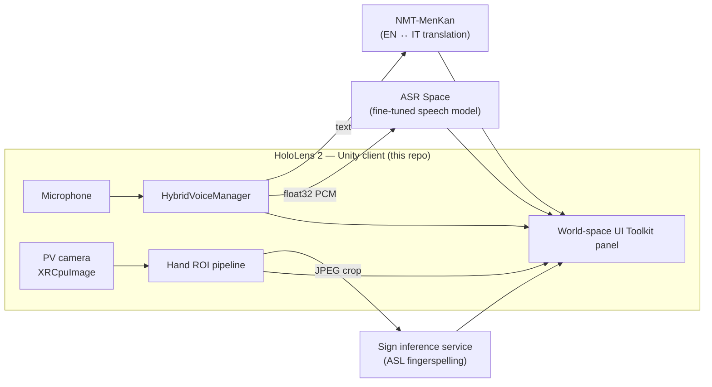
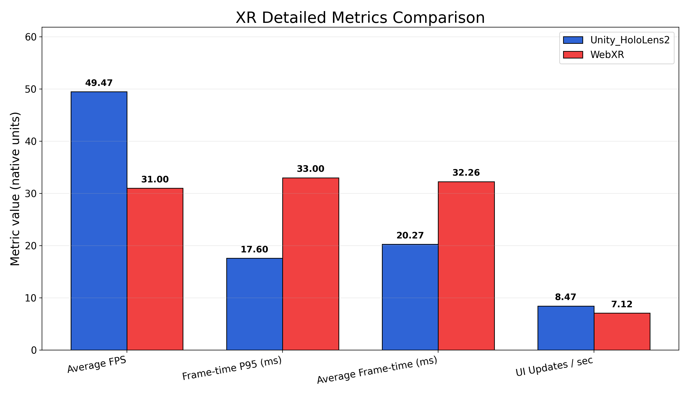

# HoloAssist

**Real-time speech, translation and sign assistance on HoloLens 2, for people with non-functional hearing.**

HoloAssist is a mixed reality app for Microsoft HoloLens 2. While the wearer talks with someone, it shows live subtitles of what is said, translates between English and Italian, and reads ASL fingerspelling through the headset camera. Everything appears on a panel that floats in the wearer's field of view, so they never have to look down at a phone.

It was built as a graduation project: **FENS 402 Engineering Design Project**, *"Extended Reality Interfaces for Speech Assistance in People with Non-Functional Hearing"*, Kadir Has University, February to May 2026.

> This repository is named `Bootstrap` because it started from a Unity XR bootstrap template. The project is HoloAssist.

---

## What it does

| Mode | How it works |
|---|---|
| **Live subtitles (ASR)** | The headset microphone is cut into short chunks and sent as raw PCM to a fine-tuned speech recognition model behind a Hugging Face Space. An on-device Windows (WinRT) recogniser can handle Italian. |
| **Translation (EN ↔ IT)** | Recognised text goes to [NMT-MenKan](https://github.com/MarcoNoLimits/NMT-MenKan), a fine-tuned NLLB-200 model served with CTranslate2, and the translation is shown under the original. |
| **Sign (ASL fingerspelling)** | Frames from the HoloLens photo/video camera are cropped to the hand, sent to an inference service, and the spelled letters are shown with their confidence and a short history. |

## Architecture

- **Client:** Unity 2022.3 LTS, OpenXR with the Mixed Reality OpenXR plugin, AR Foundation 5.2, XR Interaction Toolkit 2.6, XR Hands, built for UWP ARM64.
- **UI:** UI Toolkit (`.uxml` / `.uss`) rendered to a world-space panel that follows the head. `WorldUIInputBridge.cs` turns hand-ray hits on the panel into UI pointer events, which UI Toolkit doesn't support in world space out of the box.
- **Speech:** `HybridVoiceManager.cs` and `HololensAsrManager.cs` stream audio to the ASR Space; `ItalianWinRtSpeechRecognizer.cs` is the on-device Italian path. The audio contract is documented in [`ASR-README.md`](ASR-README.md).
- **Sign:** `HololensPvCpuImageSource.cs` grabs camera frames through AR Foundation, `SignLanguageHandRoiPipeline.cs` and `LocatableCameraArProjection.cs` find and project the hand region, and `SignInferenceClient.cs` calls the inference service. The contract is in [`ASL_PIPELINE_CONTRACT.md`](ASL_PIPELINE_CONTRACT.md).
- **Remote view:** `HololensViewStreamer.cs` serves what the headset sees over HTTP; [`stream_relay/`](stream_relay/) turns it into a smooth MJPEG stream for demos.
- **Web version:** [`web/`](web/) is a browser build of the same UI, used for the WebXR comparison below.

## Components

| Component | Where |
|---|---|
| HoloLens 2 client | this repository |
| Translation engine | [MarcoNoLimits/NMT-MenKan](https://github.com/MarcoNoLimits/NMT-MenKan) · model [`marconolimits/en-it-nmt-ct2`](https://huggingface.co/marconolimits/en-it-nmt-ct2) |
| Speech recognition | model [`Thedeezat/ASR-Hearing-Impaired`](https://huggingface.co/Thedeezat/ASR-Hearing-Impaired) · Space [`Thedeezat/ASR-Hearing-Impaired-API`](https://huggingface.co/spaces/Thedeezat/ASR-Hearing-Impaired-API) |
| Sign recognition (word level, experimental) | [MarcoNoLimits/Sign-Language-GISLR](https://github.com/MarcoNoLimits/Sign-Language-GISLR) |

## Performance study: Unity on HoloLens vs WebXR

Early in the project the team tried a WebXR version. To decide between the two, the same UI was measured on HoloLens 2 as a native Unity app and as WebXR in the HoloLens browser.

| Metric (one 15 s run each) | Unity on HoloLens 2 | WebXR |
|---|---|---|
| Average FPS (higher is better) | 49.47 | 31.00 |
| p95 frame time (lower is better) | 17.6 ms | 33.0 ms |
| Average frame time | 20.27 ms | 32.26 ms |

This is a single run per platform, so it shows a direction rather than a statistically tested result; [`Report/xr_statistical_results.md`](Report/xr_statistical_results.md) says the same. The test protocol, raw CSV and plotting script are in [`Report/`](Report/) if you want to add runs. Together with WebXR's weaker hand-joint access and drifting world-locked panels, this is why the project stayed with Unity.

## Demo

[`Video Project 3.mp4`](Video%20Project%203.mp4) (19 MB) shows the app running.

## Running it

You need Unity 2022.3 LTS with UWP build support, Visual Studio with the UWP workload, and a HoloLens 2 in developer mode.

1. Open the project in Unity Hub and open `Assets/Scenes/SampleScene.unity`.
2. Build for UWP / ARM64, then deploy from Visual Studio or with `fast_deploy.ps1`.
3. Point the service URLs (ASR, translation, sign) at your own endpoints in the inspector.

Step-by-step guides:

- [`UWP_HOLOLENS_DEPLOYMENT.md`](UWP_HOLOLENS_DEPLOYMENT.md): export, deploy and debug on HoloLens 2.
- [`UWP_CERTIFICATE_SETUP.md`](UWP_CERTIFICATE_SETUP.md): local signing certificate.
- [`Deployment.md`](Deployment.md): build and sideload commands.
- [`RELEASE_GATE_CHECKLIST.md`](RELEASE_GATE_CHECKLIST.md): release and soak-test gates.

## Team

- **Hadiza Muhammed Avidime**
- **Ahmed Marcolino Teca Kanadji**
- **Aiana Mederbek kyzy**

Supervisor: **Prof. Dr. Fabio Stroppa**, Kadir Has University.
